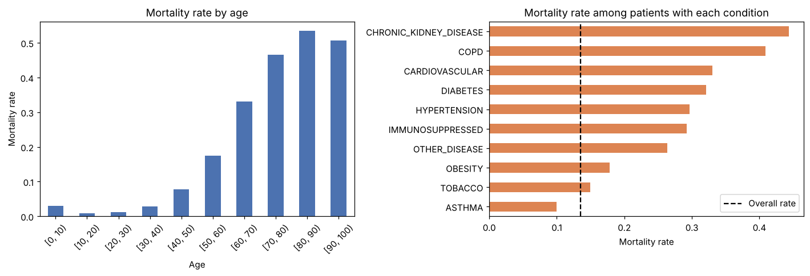
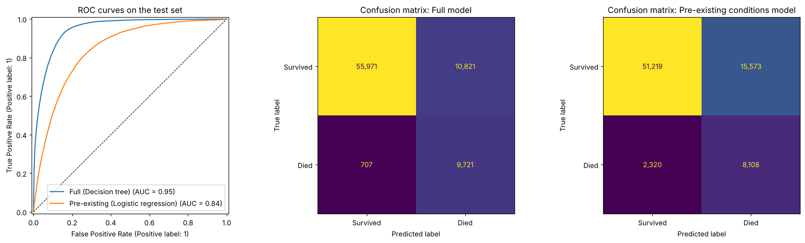
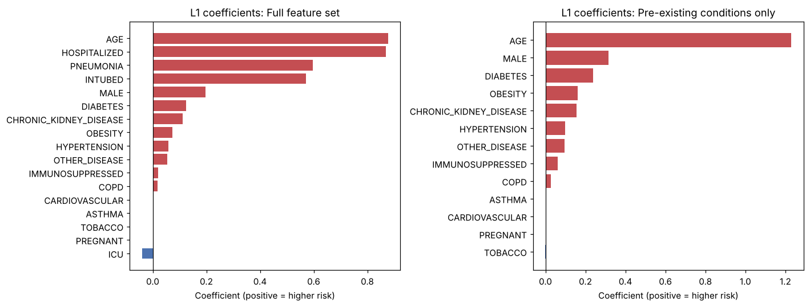
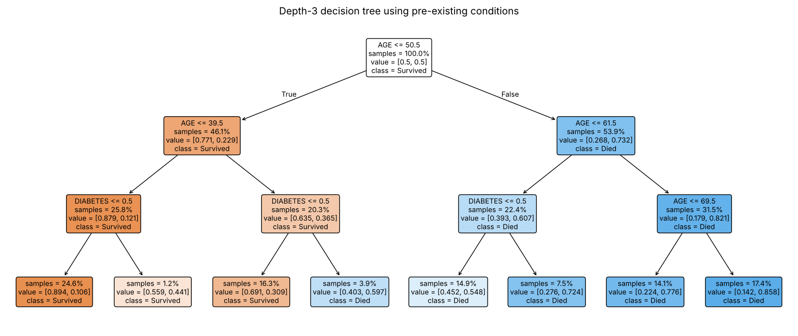

# Predicting COVID-19 Mortality from Patient Health Data

A machine learning project that estimates the probability that a confirmed COVID-19 patient dies, using their age, sex and health conditions. Built on ~386,000 confirmed cases from the Mexican government's public COVID-19 patient records.

> Originally a final group project for an Intro to Machine Learning course, later cleaned up and extended.



## Approach

1. **Cleaning:** kept only confirmed COVID cases. Recoded the dataset's 1/2 yes/no values to 1/0, treated "not applicable" codes (97) as "no" (for example, men aren't pregnant), and dropped the 1.5% of rows with unknown values (98/99).
2. **Feature selection:** L1-regularized (lasso) logistic regression, fit on the training set only.
3. **Model comparison:** logistic regression, decision tree and k-nearest neighbors, tuned with 5-fold cross-validated grid search and scored by ROC AUC.
4. **Class imbalance:** only 13.5% of patients died, so the death class is randomly oversampled *inside* each training fold. Oversampling inside the pipeline keeps duplicated patients out of the validation and test data.
5. **Evaluation:** a stratified 20% test set that isn't touched until the end.

The project trains two versions of the model:

| Model | Features |
|---|---|
| **Full** | Age, sex, chronic conditions, **plus** hospital-course data (hospitalized, pneumonia, intubated, ICU) |
| **Pre-existing conditions** | Only what's known *before* someone gets sick: age, sex, pregnancy, diabetes, COPD, obesity, hypertension, kidney disease, etc. |

## Results (held-out test set, 77,220 patients)

| Model | Best classifier | ROC AUC | Recall (died) | Precision (died) | Accuracy |
|---|---|---|---|---|---|
| Full | Decision tree (depth 7) | **0.947** | 0.932 | 0.473 | 0.851 |
| Pre-existing conditions | Logistic regression | **0.844** | 0.778 | 0.342 | 0.768 |



The full model catches 93% of patients who died. Its precision is lower because the model is tuned to flag at-risk patients rather than miss them. For a triage tool, that's the right trade-off.

### Key findings

- **Age dominates.** Mortality rises from about 3% or less for patients under 40 to about 50% for patients over 80.
- **After age, the biggest risk factors** are being male, diabetes, obesity and chronic kidney disease.
- **Hospital-course features carry a lot of signal.** Hospitalization, pneumonia and intubation raise the AUC from 0.84 to 0.95. But they describe how sick a patient already is rather than their underlying risk, so the pre-existing conditions model is the better answer to "how dangerous is COVID for someone with these conditions?"
- **Raw mortality isn't the same as an independent effect.** Cardiovascular disease has high raw mortality, but lasso drops it once age and the other conditions are accounted for.



### An interpretable tree

A shallow decision tree on pre-existing conditions shows that the model splits on age first (around 50 and 62) and then on diabetes:



## How to run

```bash
git clone <this-repo-url>
cd <repo-folder>
pip install -r requirements.txt
```

1. Download the dataset from Kaggle: [COVID-19 Dataset](https://www.kaggle.com/datasets/meirnizri/covid19-dataset).
2. Unzip it and place `Covid Data.csv` in a `data/` folder in the project root.
3. Open `covid_mortality_prediction.ipynb` and run all cells. A full run takes a few minutes.

```
├── covid_mortality_prediction.ipynb   # the full analysis
├── images/                            # figures generated by the notebook
├── data/                              # put "Covid Data.csv" here (not committed)
├── requirements.txt
└── README.md
```

## Limitations

- Because the training data is oversampled, the predicted probabilities are inflated compared with real-world death rates. They are useful for ranking patients but would need calibration before they could be read as true probabilities.
- The data comes from one country's healthcare system early in the pandemic, before vaccines, so results may not generalize.
- Unknown values were dropped rather than imputed.

## Possible next steps

- Calibrate the predicted probabilities (`CalibratedClassifierCV`).
- Try gradient-boosted trees (XGBoost/LightGBM).
- Model variation between hospitals (`MEDICAL_UNIT`).

## Team

Group project by: Robert Dreyer, _[teammate names]_

## Tools

Python, pandas, scikit-learn, imbalanced-learn, matplotlib, Jupyter
